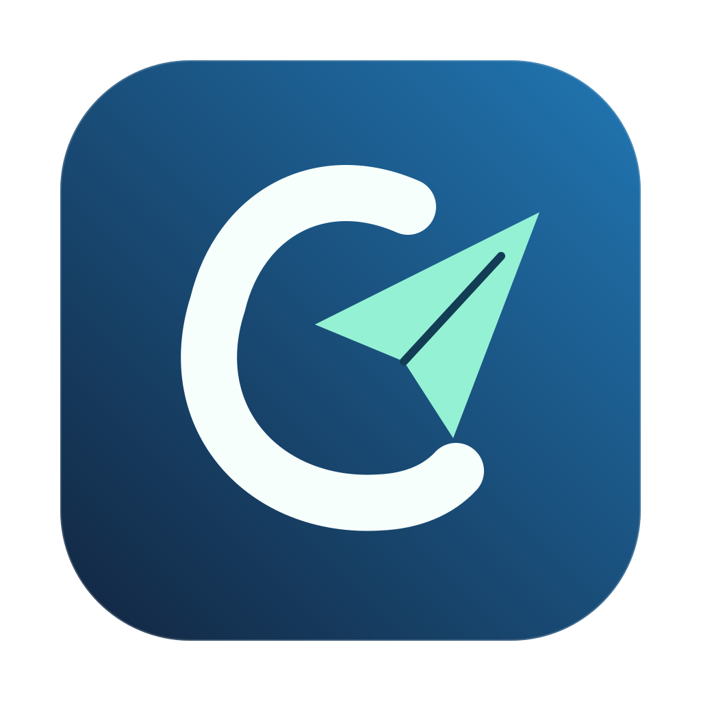

<p align="center">
  
</p>

# CleanPilot

Ứng dụng dọn dung lượng macOS với giao diện đơn giản, luồng chính bằng tiếng Việt và khả năng hoàn tác qua Thùng rác. Phát triển từ mã nguồn [DiskWise](https://github.com/DreamOfXM/diskwise), với cách tổ chức lấy cảm hứng từ CleanMyMac.

## Sử dụng

**Quét ngay → Xem kết quả → Chọn mục → Chuyển vào Thùng rác.**

- **Quét thông minh:** kiểm tra các vị trí cache đã biết, không tự động dọn file.
- **Chọn mục đề xuất:** chọn các mục được cơ sở dữ liệu đánh giá là dọn không ảnh hưởng. Các mục cần tải lại hoặc có thể mất dữ liệu cần xem và chọn riêng.
- **Dọn dẹp:** xem trước và xác nhận; có thể hoàn tác khi file vẫn còn trong Thùng rác.
- **Công cụ khác:** tìm file lớn, file trùng, thống kê ổ đĩa, gỡ ứng dụng, xem dữ liệu còn sót.
- **Công cụ nâng cao:** cache lập trình, node_modules, thông tin Docker và chẩn đoán.

Một số giải thích chuyên sâu và tên cache vẫn dùng tiếng Anh. Docker chỉ xem; ứng dụng không tự xóa vĩnh viễn. Dọn sạch Thùng rác qua Finder mới giải phóng dung lượng thật và không thể hoàn tác.

## Build trên macOS

Cần macOS 13 trở lên và Xcode Command Line Tools. Máy Apple Silicon:

```sh
git clone https://github.com/huynhtrungthoai/clean-cache-macos.git CleanPilot
cd CleanPilot
SIGN_IDENTITY=none ARCH=arm64 bash build_app/build.sh
open build_app/CleanPilot.app
```

Build cả Apple Silicon và Intel: dùng `ARCH=universal`.

Script kiểm tra chuỗi dịch, build release, chạy toàn bộ SelfTest, đóng gói tài nguyên và xác minh chữ ký. Kết quả:

- `build_app/CleanPilot.app`
- `dist/CleanPilot-2.3.dmg`

Bản build cục bộ dùng chữ ký ad-hoc, chưa được Apple notarize.

## Nguồn gốc

CleanPilot tùy chỉnh giao diện, điều hướng, ngôn ngữ, tên và logo trên nền DiskWise. Tên target Swift, CLI `diskwise` và bundle ID được giữ để tương thích với lõi và cài đặt hiện có.

Giữ nguyên [LICENSE](LICENSE) MIT ban đầu của repository đích. Mã nguồn DiskWise gốc đi kèm [Apache License 2.0](LICENSE-APACHE-2.0) và [NOTICE](NOTICE). Xem [README gốc](README.upstream.md), [hướng dẫn tiếng Việt](README.vi.md) và tài liệu trong `docs/`.

Thư mục `website/` là website gốc của DiskWise; workflow website chỉ chạy thủ công.
